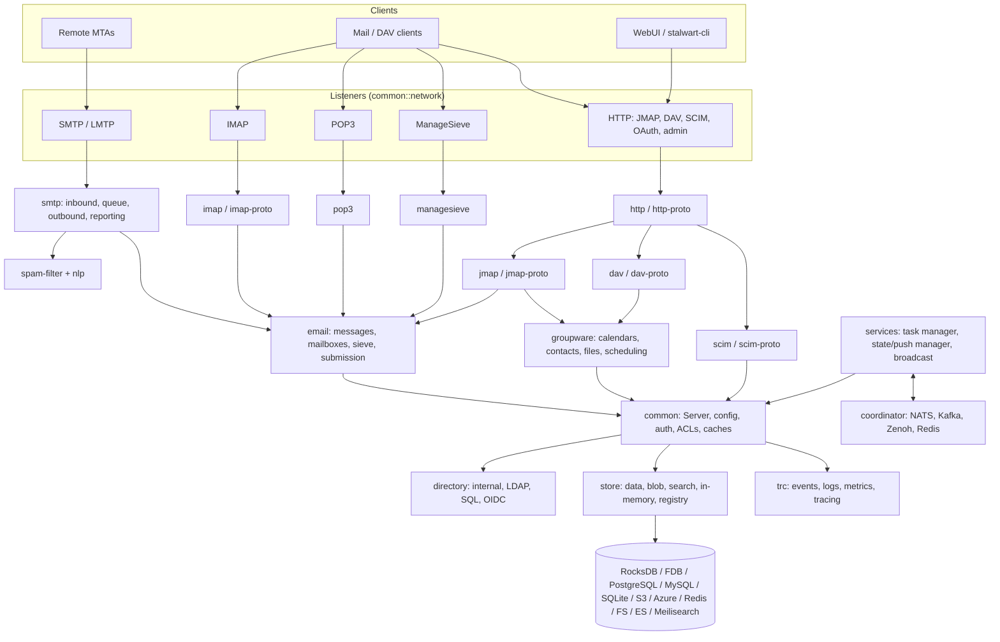

# Architecture

Stalwart is a single Rust binary built from a Cargo workspace of 29 members (28 crates under `crates/` plus `tests/`). This document describes the stack, how the crates fit together, and how a request moves through the system. Versions are taken from the crate manifests at `v0.16.23`.

## Stack

| Layer | Choice | Source |
|-------|--------|--------|
| Language | Rust, edition 2024 | every `Cargo.toml` |
| Async runtime | Tokio 1.53 | `crates/main/Cargo.toml` |
| Allocator | jemalloc via `tikv-jemallocator` 0.7 (not on MSVC or FreeBSD) | `crates/main` |
| TLS | rustls 0.23 with the AWS-LC crypto provider, `tokio-rustls` 0.26; `rcgen` 0.14, `x509-parser` 0.18 | `main.rs` installs `aws_lc_rs` as the default provider |
| HTTP | hyper 1.11 (HTTP/1 and HTTP/2 server), reqwest 0.13 (client) | `crates/http`, `crates/common` |
| Mail libraries (Stalwart Labs) | `mail-parser` 0.11, `mail-auth` 0.13 (DKIM, SPF, DMARC, ARC), `mail-builder` 1.0, `smtp-proto` 0.2, `sieve-rs` 0.7, `calcard` 0.3, `jmap-tools` 0.1 | crate manifests |
| Serialization | rkyv 0.8 (zero-copy archived records), serde / serde_json | `crates/types`, `crates/store` |
| Crypto | `sequoia-openpgp` 2.4 and `rasn` 0.28 (S/MIME) for encryption at rest, `aes-gcm` 0.11, `argon2` 0.6 (password hashing) | `crates/email`, `crates/common`, `crates/directory` |
| Directories | `ldap3` 0.12, SQL backends, OIDC | `crates/directory` |
| Observability | OpenTelemetry (a Stalwart Labs fork pulled from git), `prometheus` 0.14 | `crates/common` |
| Text processing | in-house `nlp` crate (tokenizers, classifier), `whatlang` 0.18 for language detection | `crates/nlp` |
| Test harness | `testcontainers` 0.28 | `tests/Cargo.toml` |

### Storage backends (Cargo features)

| Feature | Library | Role |
|---------|---------|------|
| `rocks` (default) | `rocksdb` 0.24 | embedded key-value data store |
| `foundationdb` | `foundationdb` 0.11 (FDB 7.4) | distributed data store |
| `postgres` | `tokio-postgres` 0.7, `deadpool-postgres` 0.14 | data / blob / search store, SQL directory |
| `mysql` | `mysql_async` 0.37 | data / blob / search store, SQL directory |
| `sqlite` | `rusqlite` 0.40 (bundled), `r2d2` 0.8 | data store, SQL directory |
| `s3` | `rust-s3` 0.37 | blob store |
| `azure` | `azure_storage_blobs` 0.21 | blob store |
| `redis` | `redis` 1.6 (cluster, sentinel) | in-memory store, cluster coordination |
| (always) | filesystem, memory, Elasticsearch/OpenSearch and Meilisearch over HTTP | blob, lookup and search stores |

Backend implementations live in `crates/store/src/backend/` (`azure`, `composite`, `elastic`, `ephemeral`, `foundationdb`, `fs`, `http`, `meili`, `memory`, `mysql`, `postgres`, `redis`, `rocksdb`, `s3`, `sqlite`).

### Cluster coordination (Cargo features)

| Feature | Library |
|---------|---------|
| `nats` | `async-nats` 0.50 |
| `kafka` | `rdkafka` 0.39 |
| `zenoh` | `zenoh` 1.10 |
| `redis` | `redis` pub/sub |

Implementations live in `crates/coordinator/src/backend/`.

The default build is `rocks` + `enterprise`. Release and container builds use `sqlite postgres mysql rocks s3 redis azure nats enterprise`; the FoundationDB build swaps in `foundationdb` (`Dockerfile`, `Dockerfile.fdb`, `.github/workflows/ci.yml`).

## System design

### Boot sequence

`crates/main/src/main.rs` is short and shows the whole lifecycle:

1. Install AWS-LC as the rustls crypto provider and build shared outbound TLS configs.
2. `BootManager::init()` (`crates/common/src/manager/boot.rs`) parses the command line (`--config`, `--export`, `--import`, `--console`, `--help`, `--version`) or `CONFIG_PATH`, then initializes the **registry store** from `config.json`. The registry holds every configuration object; `config.json` only locates the datastore.
3. Safe defaults are inserted if missing, listeners are parsed, bound, and privileges dropped (`RUN_AS_USER`/`RUN_AS_GROUP`).
4. Storage, telemetry, `Core`, data and caches are parsed from the registry. With no config file the server enters **bootstrap mode** (port 8080 open for setup); `STALWART_RECOVERY_MODE` enters **recovery mode**.
5. `migration::try_migrate` upgrades the database; startup aborts if migration fails.
6. Background services start (`services::StartServices`), then the SMTP queue manager.
7. Each listener spawns a session manager for its protocol: `SmtpSessionManager` (SMTP and LMTP), `HttpSessionManager`, `ImapSessionManager`, `Pop3SessionManager`, `ManageSieveSessionManager`.
8. A broadcast subscriber joins the cluster event bus; the process then waits for a shutdown signal and drains.

### Components

| Crate | Responsibility |
|-------|----------------|
| `main` (binary `stalwart`) | Entry point and wiring; feature flags select backends and the enterprise build. |
| `common` | The shared `Server`/`Core` object: configuration parsing, authentication, ACLs and sharing, caches, expressions, i18n (generated at build time from `resources/locales/i18n.yml`), listeners and TLS/ACME, telemetry setup, backup/restore, store console, web-application bundles. |
| `registry` | Typed schema for configuration objects (structs, enums, properties) exposed as JMAP objects. The serialized schema ships as `resources/schema/schema.json.gz`. |
| `store` | Storage abstraction: data store (key-value with batched writes, assertions and change log), blob store, full-text search store, in-memory store, query engine, and the registry store. |
| `types` | Core domain types: IDs, collections, ACLs, keywords, blob hashes, special-use mailboxes. |
| `directory` | Principal lookup and authentication against the internal directory, LDAP, SQL and OIDC. |
| `email` | Mail domain logic shared by all access protocols: message ingestion, mailboxes, identities, Sieve execution, submission, push. |
| `groupware` | Calendars, contacts, files and iTIP/iMIP scheduling shared by DAV and JMAP. |
| `smtp` | SMTP/LMTP inbound sessions, queue and outbound delivery, DMARC/TLS reporting, Sieve and milter/MTA hooks. |
| `spam-filter`, `nlp` | Rule-based analysis, DNSBL, Pyzor, HTML and URL analysis, statistical classifier and language tokenizers. |
| `imap`, `imap-proto` | IMAP session handling and the protocol parser/serializer. |
| `pop3`, `managesieve` | POP3 and ManageSieve servers. |
| `http`, `http-proto` | HTTP server, request routing, OAuth/auth endpoints, form handling, diagnostics and telemetry streams. |
| `jmap`, `jmap-proto` | JMAP method dispatch for mail, calendars, contacts, files, principals, sieve, quotas, and the registry (management) objects. |
| `dav`, `dav-proto` | CalDAV, CardDAV and WebDAV request handling and XML protocol. |
| `scim`, `scim-proto` | SCIM v2 users, groups, bulk and discovery endpoints. |
| `services` | Background work: the task manager (ACME, DKIM rotation, DNS, alarms, iMIP, indexing, report delivery, spam-classifier training, account destruction, maintenance), the state manager (JMAP/Web push, event source) and the cluster broadcast publisher/subscriber. |
| `coordinator` | Pluggable cluster messaging: NATS, Kafka, Zenoh, Redis. |
| `trc` | Strongly typed event system used for logging, tracing, metrics and webhooks. |
| `migration` | Database and configuration migrations, including the `v0.15 -> v0.16` conversion. |
| `utils` | Codecs, caches, cron, glob, snowflake IDs, templates, TLS helpers. |
| `tests` | Integration test suite (directory, SMTP, IMAP, JMAP, WebDAV, SCIM, store, cluster, telemetry). |

## Data flow

**Inbound message.** A remote MTA connects to an SMTP listener. The `smtp` crate runs the session, applying SPF, DKIM, ARC and DMARC verification (`mail-auth`), throttles, Sieve and milter/MTA hooks, then the `spam-filter`. Accepted messages either go to the queue for relay or are delivered locally: the `email` crate parses the message (`mail-parser`), runs user Sieve scripts, writes metadata to the data store, the raw message to the blob store and terms to the search store, and the state manager notifies connected JMAP/IMAP clients.

**Client access.** IMAP, POP3 and JMAP requests resolve the principal through `directory`, check ACLs in `common`, and read and write through `email` (or `groupware` for DAV and JMAP calendar/contact/file objects) to `store`.

**Management.** The WebUI and `stalwart-cli` call `POST /jmap` with registry objects (domains, accounts, listeners, stores, spam rules). Writes go to the registry in the datastore and are broadcast to other nodes through the coordinator, so every node converges on the same configuration. A small set of helper HTTP endpoints (login, account introspection, schema retrieval, Server-Sent Events telemetry) is documented in `api/v1/openapi.yml`.

**Cluster.** Nodes share the datastore and exchange events (configuration reloads, cache invalidation, push notifications) through the coordinator. `STALWART_ROLE` and `STALWART_PUSH_SHARD` assign a node's role and push shard.

## Key directories

| Path | Contents |
|------|----------|
| `crates/` | The workspace crates above. |
| `tests/` | Integration tests (`tests/src/`), test resources and fixtures (`tests/resources/`), and a Docker Compose stack of external services (`tests/docker/`). |
| `api/v1/openapi.yml` | OpenAPI 3.0 description of the helper management endpoints. |
| `resources/` | AppArmor profile, systemd unit, HTML templates, locale strings, registry schema, maintenance scripts (`migrate_v016.py`, blob and FoundationDB repair tools). |
| `install.sh` | Installer for Linux, macOS and FreeBSD. |
| `Dockerfile`, `Dockerfile.build`, `Dockerfile.fdb`, `docker-bake.hcl` | Container and cross-compilation builds. |
| `UPGRADING/` | Per-release upgrade guides. |
| `LICENSES/` | AGPL-3.0 and SELv2 texts. |
